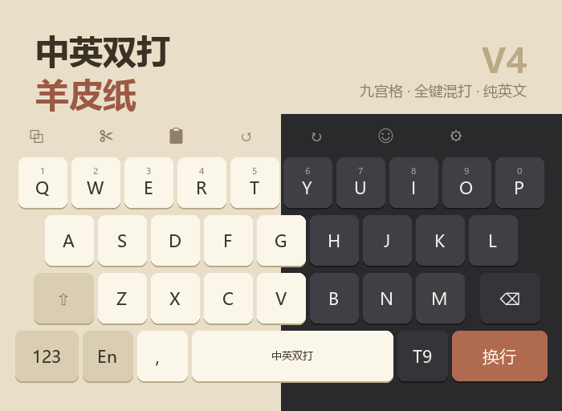

# 中英双打羊皮纸

[元书输入法](https://apps.apple.com/us/app/元书输入法/id6744464701)（iOS）的
**输入方案 + 键盘皮肤**整套配置。

当前公开版：**5.2**（2026-10-10）。修复纯英文选词后不立即添加空格的问题，
同步个人版为 V10.3。公开版完整配置包、安卓包和三套 V5.2 配套皮肤均在
[GitHub Releases 5.2](https://github.com/robavionix/rime-parchment/releases/tag/v5.2) 下载。
本地构建产物位于 `dist/`，三套皮肤保持原有布局。

适合同时有中英文混打输入需求的人群。



## 特点

### 三套键盘，两套 Rime 方案

| 键盘 | Rime 方案 | 说明 |
|---|---|---|
| **26 键中英混打**（主键盘） | `rime_ice` | 中英文同时出候选 |
| **九宫格** | `rime_ice`（同上） | 数字映射并入同一方案 |
| **纯英文** | `English Nano` | 有词库、有前缀补全 |

切换键**同时切键盘和方案**（`combine` 动作），不会出现「键盘换了方案没换」。
三套键盘两两直达，都只要点一下：九宫格空格左边有 `En` 键去纯英文，纯英文左下角
有 `T9` 键回九宫格（5.1 新增），26 键上原有 `En` 与 `T9`。

**5.0 起九宫格不再是独立方案。** 上游的 `t9` 本就是 `rime_ice` 的派生
（`__include: rime_ice.schema.yaml`），只多了一层数字映射；把那层并进
`rime_ice` 之后，两个键盘共用一套中文方案。

这不是为了精简，是修一个从 4.x 一路带过来的 bug：**元书记住的是上次用过的
Rime 方案，键盘布局却由皮肤的 `primaryKeyboard` 固定**，两者各记各的。只要
上次停在 26 键，下次呼出九宫格时方案还是 `rime_ice`——它不认识数字键发出的
`2`～`9`，于是原样上屏成一串数字，必须切一下键盘才能恢复。

把 `t9` 排进 `schema_list` 第一位治不了（实测无效）：那只决定全新部署时的
初始方案，覆盖不了运行时记忆。而元书皮肤格式里没有「键盘加载时绑定方案」的
机制，`switchRimeSchema` 只存在于按键动作里。**只有一套中文方案时，错配不
可能发生。**

### 取舍：先把误判压到最低，容错排第二

这是 5.1 定下的原则，中文英文同一把尺子。

- **误判**：你打的是对的，它却给了别的。打 `to` 出「头」、打 `am` 出「按」、
  打 `were` 出 `we're`、打 `bim`（避免）出「并」。
- **容错**：你打错了，它帮你改回来。打 `recieve` 出 `receive`、打 `wnag` 出「王」。

纠对一次省一个键，纠错一次要删掉重打，还未必发现得了。所以两者冲突时砍容错：
任何纠错规则、词库别名、派生拼写，只要实测会让词库里真实存在的词丢掉首位
（哪怕只误伤一个生僻词），就摘掉。5.0 及之前的做法正相反，结果是：

| 被摘掉的 | 它造成的误判 |
|---|---|
| 英文错拼变体 19.6 万条 | 词库没收的词被「纠」成别的词：`icar → vicar` |
| 上游拼音纠错 37 条里的 23 条 | 英文被读成拼音：`to → 头`、`done → 东阿`、`coming → 聪明`、`juice → 九册`；简拼被吞：`sih`（似乎）出「是」、`hzi`（孩子）出「只」 |
| 5.0 自己加的 3 条相邻键容错 | `am → 按`、`team → 特案`；`bim`（避免）、`huam`（画面）、`wenh`（文化）、`renh`（任何）全被读成单个音节 |
| 英文词尾替换 4 条 | `terrence → terrance` |
| 5.0 随带的附加词库里 2 条小写字母编码（该词库 5.1 起不再随带） | `t分布` 把 `t` 变成了一个音节，于是单按 `t` 没有候选，`went`（问题）、`xit`（系统）打不出；九宫格单按 `8` 同理 |

留下的 14 条拼音纠错（`wia → wai`、`jei → jie`、`riu → rui` 这类换位）实测零误判。

每一条的数据、量法、如何恢复，见 [docs/NOTES.md](docs/NOTES.md) 的「5.1」一节。
量这些东西的工具在仓库里没有（它依赖本机的小狼毫），原理写在同一节。

### 英文输入做了什么

上游雾凇的默认取向是「中文为主，英文偶尔冒头」，本项目相反：

- **移除 `reduce_english_filter`** —— 上游默认把一批英文单词压到第 2 位之后
- **移除 `corrector`** —— 它会把 `amazon` 纠成「阿妈粽」抢占首选
  （代价是失去中文错音提示，补丁中留有注释可一键恢复）
- **英文词库重建** —— 42,999 条，按真实词频统一赋权
- **前缀补全** —— 打 `inter` 直接出 `international`
- **纯英文选词后自动加空格** —— 按空格或点选候选，立即提交 `hello `；
  回车提交原始英文同样加尾空格。接标点前可退格删去空格。
  混打键盘仍只在连续两个英文词之间补空格。
- **原词优先** —— 你打的小写串如果本身是词库里的词，首位就是它：
  `were` 不再出 `we're`，`its` 不再出 `it's`，`sat` 不再出 `Saturday`，
  `may` 不再出 `May`。只有字面不成词的缩约写法照旧展开（`dont → don't`）

英文这边**没有拼写纠错**（5.0 有，5.1 摘了，原因见上）。打错了就是没有候选，
不会悄悄换成别的词。

**混打的固有代价**：一个英文单词如果本身就是合法拼音（`you`、`he`、`can`、
`like`、`take`），首位出的是中文，英文排第二。这类在 3.7 万个英文词里有六百多个，
没法靠配置消掉 —— 要连着打英文时切到纯英文键盘，这也是三套键盘两两直达的原因。
开着前后鼻音模糊音时还会多几个：`ten`、`tin`、`din` 首位出「疼 听 定」。

### 配色

浅色为羊皮纸护眼底，深色为柔和灰（非纯黑），按键文字对比度约 9:1。

## 安卓

Rime 方案层可移植到 **[fcitx5-android](https://github.com/fcitx5-android/fcitx5-android)**
（需另装 Rime 插件）或 **同文输入法 Trime**：

```bash
./build-rime.sh android    # → dist/rime-android
```

| App | 配置目录 |
|---|---|
| fcitx5-android | `/Android/data/org.fcitx.fcitx5.android/files/data/rime` |
| 同文 Trime | `/rime` |

**两点限制：**

1. **没有九宫格。** 九宫格要用 `t9_processor` 才能把数字串还原成拼音显示，
   那是仓输入法与元书**编译进 App 的原生组件，不属于 librime**，安卓端加载
   会失败。`build-rime.sh android` 会自动剥离 `rime_ice.custom.yaml` 里
   `T9-ONLY` 标记之间的内容（数字映射、`t9_processor` 等），安卓拿到的是一份
   纯 26 键配置。**同一处剥离也适用于 PC 版**（鼠须管 / 小狼毫）。
2. **皮肤完全不可移植。** 元书皮肤格式是其专有；且本项目「切键盘同时切方案」
   依赖 `combine` / `switchRimeSchema` / 自定义键盘，均为元书特有能力，
   安卓端无对等物。键盘外观请用所选 App 自带的主题另配。

英文词库、原词优先、前缀补全等核心改进都在方案层，跨平台通用。

## 目录结构

```
vendor/rime-ice/     上游雾凇基底（不计入版本控制，用 fetch-upstream.sh 拉取）
src/
  patches/           Rime 补丁，只打补丁不改上游文件
  en_dicts/          生成的英文词库
  tools/             词库构建脚本与场景词表
skin/
  jsonnet/           皮肤源码
  light/ dark/       编译产物
build-rime.sh        组装 Rime 配置 → dist/rime
build.sh             编译皮肤 → skin/light、skin/dark
docs/NOTES.md        完整开发记录：每处改动的原因与踩过的坑
```

## 构建

需要 [go-jsonnet](https://github.com/google/go-jsonnet)（皮肤）与 Python 3（词库）。

```bash
./fetch-upstream.sh                          # 首次：拉取上游雾凇基底
./build.sh                                   # 编译皮肤
python3 src/tools/build_en_dict.py <素材目录> vendor/rime-ice   # 重建英文词库（素材见脚本开头）
./build-rime.sh                              # 组装 Rime 配置（iOS 元书版）
./build-rime.sh android                      # 组装 Rime 配置（安卓版）
python src/tools/package_release.py --public 5.2 --personal 10.3 --previous 10.2
                                            # 校验并同步完整配置包与三套皮肤
```

打包工具需要 PyYAML 和 `tools/jsonnet.exe`。打包前会核对皮肤源码与编译结果、
键盘和方案绑定；打包后逐文件校验压缩包。个人版保留个人词库与语言模型，
旧版目录和同名包在更新完成后由新版本替换。

皮肤也可在手机上编译：长按皮肤 → 「运行 main.jsonnet」。

### 调参

- 皮肤：`skin/jsonnet/Settings.libsonnet`（布局、配色、工具栏、切换方案）
- 场景词：`src/tools/curated_terms.txt`
- 拼音纠错规则：`src/patches/rime_ice.custom.yaml` 的 `speller/algebra`，
  摘掉的每条都留着注释，去掉行首 `# ` 即恢复
- 英文错拼变体：`src/tools/build_en_dict.py` 的 `TYPO_ENABLED`（默认关）
- 英文别名谁排前面：同一文件的 `ALIAS_FIRST`

## 致谢

- 键盘皮肤改造自 **[空山素影](https://github.com/luozikuan/kongshan-suying)**，
  作者 **luozikuan / 罗滋宽**。布局、Jsonnet 模块结构、划动体系等基础工作均出自原作者。
  原仓库未附 LICENSE，若原作者对本衍生项目有异议，请提 issue，我会立即配合调整。
- 输入方案基于 **[雾凇拼音 rime-ice](https://github.com/iDvel/rime-ice)**（GPLv3），作者 **Dvel**。
- 英文词频取自 [FrequencyWords](https://github.com/hermitdave/FrequencyWords)（OpenSubtitles）；
  拼写校验表取自 [english-words](https://github.com/dwyl/english-words)。

## 许可

输入方案部分继承雾凇拼音的 **GPLv3**。构建产物中随附上游 LICENSE。
